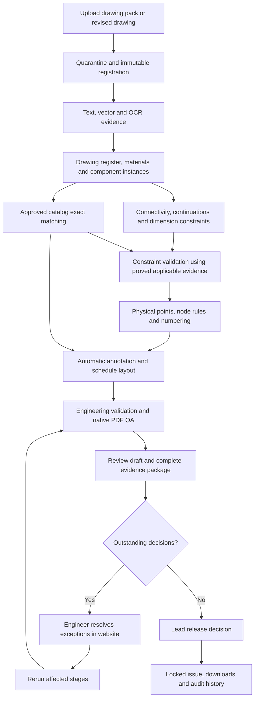

# CAESAR ISO — end-to-end automation plan

Revised 22 November 2026 (Australia/Sydney).

**Status: proposed implementation plan, not implemented automation.** The deployed
application is the manual engineering-review foundation. This document changes
the build target to automatic preparation of a complete, traceable review issue,
with engineer intervention for exceptions and approval rather than routine data
entry at every stage. No live application or hosting settings are changed by
this planning update.

Source: the user-supplied 11-page `CAESAR_ISO_Website_Coding_Plan.pdf`, migration
baseline 10 November 2026; SHA-256
`e2b0ae511754c75de70cd3624faa14f9c4482b7767e7afdea85d44a7fd8faa3d`.
Page references below identify original requirements. Job orchestration,
exception-driven operation and the detailed revised-drawing flow are proposed
implementation additions, not claims about features already present.

## 1. Product outcome

An engineer selects an approved project policy and catalog versions, uploads a
drawing pack, and receives an automatically generated review package:

- All sheets registered and displayed within the website.
- Materials, component instances, pipe connectivity, continuations and physical
  point proposals, with source evidence and unresolved facts made visible.
- Exact dimension calculations where the sources sufficiently constrain them.
- Deterministic node numbering, support checks and catalog-backed schedules.
- Automatically positioned, individually editable native PDF annotations.
- Draft PDF, schedules, provenance, exception report, annotation manifest and
  changes from the previous issue.

Successful stages advance automatically. Routine extraction, catalog matching,
numbering, layout and draft generation do not require repeated button clicks.
Users resolve an assigned exception queue in the existing drawing viewer. A
correction reruns only dependent stages. The pipeline prepares and validates
the issue automatically; a lead approves the exact revision and artifact set
before it is atomically published as a locked issue.

The target is **straight-through review-draft generation for qualified drawings**.
Arbitrary drawings must be accepted into registration or explicitly rejected by
an input policy; unsupported or unreadable features produce evidence-linked
exceptions. Automation must not invent engineering facts to achieve a nominal
100% completion rate. A qualified drawing is defined by a **versioned policy**:
supported profile, required regions, evidence prerequisites, recognition and
reconciliation checks. Record qualification outcomes for every input, including
failures; do not exclude failed inputs retrospectively to inflate completion.
Fully unattended engineering approval is not the original
plan's requirement (pp. 3, 7, 9–10).

The website remains at `https://easyai.com.au/stress/`. The website is the primary
drawing editor. PDF export uses standard annotation types with a documented
cross-editor test matrix; it has no Acrobat-only dependency. Universal editing
support in every PDF application cannot be promised. A proprietary CAESAR II
model-file exporter and a stress solver remain separate scope (p. 1).

## 2. Current foundation and missing work

| Area | Present in the deployed code | Required automation |
| --- | --- | --- |
| Sources/viewer | Original bytes/hashes, page geometry/text, private access, PDF.js/SVG editing | Batch/ZIP intake, title/revision/line detection, per-page evidence, source supersession |
| Engineering | Exact unit parsing, manually ordered nodes, numbering, reason codes | Recognized component ports, pipe graph, dimensional constraints, continuation proposals, automatic physical-point proposals |
| Materials/catalogs | Manual inventory, approved catalog versions, exact matching, row snapshots | Extract material rows/callouts, track located instances, reconcile quantities and batch-match specifications |
| Layout/export | Native annotation generation, draft ZIP, source-content checks, in-site preview | Exclusion zones, collision-free layout, leader routing, automatic scheduling and complete round-trip QA |
| Revisions | Saved project snapshots and restore | Match revised PDFs, select active sheets, rebase identities/overrides and invalidate affected approvals |
| Operations/release | Working cPanel Python/Passenger pilot and basic account/project permissions | Durable jobs, isolated workers, security hardening, independent drawing approval and production operations |

Implementation evidence: `services/api/main.py:upload/change/export`,
`packages/pdf/__init__.py:inspect_pdf/export_bundle`,
`packages/engineering/__init__.py:topology/renumber/compute_reasons`,
`packages/catalogs/__init__.py:exact_match`, and `services/api/workflows.py`.
The present `inspect_pdf()` reads existing text; it is not a generic drawing
recognizer. Present graph edges derive from manually ordered nodes. A revised
upload currently appends sheets, and exports include those registered sheets;
neither operation implements drawing-revision reconciliation.

## 3. Automatic pipeline

The correction loop represents dependency-based recomputation: an annotation
movement reruns layout/QA; a dimension correction reruns affected constraints,
nodes and downstream results. It does not rerun every extractor unnecessarily.
Independent sheets are processed in parallel. Catalog matching and graph
analysis can run in parallel; only proved, applicable manufacturer dimensions
may become engineering constraints. A reference-only catalog length is not a
measurement of the installed component.

| Stage | Automatic work and output | Exception/failure behavior |
| --- | --- | --- |
| 0. Intake | Authenticate before expensive parsing; stream limits/quotas; inspect signatures; quarantine originals; safely enumerate batch/ZIP members | Reject unauthorized, oversized, unsafe or excessive-expansion input; never execute embedded code/macros |
| 1. Register | Hash files; register every page, transforms, printed IDs/revisions, full line IDs and vector/raster/mixed classification | Conflicting titles, unreadable IDs and duplicate identities remain explicit; filenames are not line identity |
| 2. Evidence extraction | Native text spans, vector paths, images and bounding boxes; OCR/stroke-text recognition only where required | Preserve raw observations, methods and uncertainty; empty OCR is not proof a region contains no items |
| 3. Inventory/instances | Find fabrication/erection tables, normalize specification fields, locate callouts and component instances; retain source quantities | Missing/excess/duplicate/ambiguous/size-mismatched/unreadable/unlocated items remain in a complete reconciliation ledger |
| 4. Physical graph | Propose centreline connectivity, component ports, junctions, main/branches and cross-sheet references | Crossings are not automatically tees; ambiguous flow/main route or topology becomes a decision, not a guessed connection |
| 5. Dimensions/continuations | Parse exact units and signed XYZ; solve sufficiently constrained chains; compare full continuation identity, size, topology and per-axis deltas | Conflicting/underdetermined constraints retain null values and source evidence; unproved continuations are not merged |
| 6. Catalog enrichment | Pin approved datasets; extract matching keys; resolve unique exact records and snapshot provenance/scope | Zero or multiple exact candidates, unknown bore/vendor/operator scope and quantity conflicts become typed exceptions |
| 7. Nodes/numbering | Apply component rules; unify proved physical interfaces; calculate route support distances; number complete mains, branches and lines | No fabricated physical station; justified visual proposals may be blue; wholly unlocated items get exceptions without invented markers |
| 8. Layout | Protect title blocks, source dimensions, material lists and NORTH; place bubbles/leaders, red triads, tables and warnings | Preserve graphic overrides; unresolved source collisions or out-of-bounds objects are visible and cannot pass clean-layout QA |
| 9. Draft/QA | Generate native PDF annotations, schedules, source/catalog manifests, validation and revision reports; edit/save/reopen checks | Publish no partial artifacts; failed required native-object/source-integrity QA means EXPORT_FAILED |
| 10. Review/release | Assign outstanding decisions; rerun affected work after corrections; enforce role-separated release; lock exact approved artifacts | No critical unresolved modelling evidence or stale approval may pass VERIFIED_FOR_MODELLING |

The original stage requirements are on pp. 3–8. Automated draft output remains
available with explicitly labelled engineering exceptions when output QA passes.
If no feature has a defensible location, the pipeline can still register the
drawing and deliver an exception report; it must not create fake nodes merely
to satisfy the current export API's one-node minimum. That API contract must
be revised before supporting this outcome. A stage with engineering ambiguity
normally succeeds with proposals and exceptions so safe downstream draft work
continues. `WAITING_REVIEW` blocks only work that cannot safely proceed; it must
not freeze the whole project at the first uncertain item.

### Website flow and arrival triggers

The project page exposes **Upload drawings**, **Upload revision**, a persistent
progress timeline, the latest draft and the exception queue. Processing continues
if the browser tab closes. Each exception opens the relevant sheet/region and
shows its evidence, consequence and correction options. Users can inspect the
original immediately and review proposed overlays as versioned results arrive.
Keep the existing macOS-inspired visual style and avoid exposing queue internals
in the engineer's normal workflow.

Upload completion starts the pipeline automatically. A supported, explicitly
configured private project inbox/API integration can later start the same flow
when a new content hash arrives. This does not watch or install anything on a
user's Windows/Mac computer. Direct placement of PDFs in the public `/stress/`
folder is not an intake mechanism; sources go through authorized quarantine.

Saving an engineering correction triggers dependent stages. A new catalog
publication creates an impact notice, not silent adoption: explicit project
adoption creates a new pinned snapshot/run and invalidates affected approvals.
An unchanged file upload is idempotent. A changed drawing uses source-revision
reconciliation rather than appending a replacement as unrelated extra pages.

## 4. Engineering rules automation must preserve

These are original requirements, not optional recognition heuristics:

- **Three separate models:** engineering XYZ/station and physical identity;
  PDF presentation coordinates/transforms; native output objects (pp. 2–3, 7).
  Never turn paper distances, OCR boxes or symbol widths into physical lengths.
- **Component ports:** flange face plus its distinct opposite black-dot end;
  tee intersection; dimension-supported elbow COD; each distinct support
  station; valve/inline-instrument process ends; one process connection for a
  single-ended PIT. Reuse proved shared interfaces (p. 4).
- **Support threshold:** two adjacent supports on the same physical route at
  separation ≤152.4 mm flag the downstream point blue. Keep exact separation,
  paired UUIDs and evidence. Do not merge merely nearby supports (p. 4).
- **Continuations:** a proved shared point has one UUID/number and multiple
  sheet representations. A plausible mismatch ≥25.4 mm on any axis is
  provisional, with both depictions blue and original coordinates/deltas
  retained. Smaller deltas use the configured engineering tolerance (p. 5).
- **Numbering:** first line 10, then increments of 10 on the whole main;
  branches use the next free higher hundreds with adequate reserved space;
  each new line starts at the next higher thousand after the previous line's
  complete allocation. Authorized project policy may override the initial 10.
  Returning to a known line reuses its namespace. Sheet order is not route
  order; main route/takeoff order must be accepted before verified release (p. 5).
- **Identity survives numbering:** renumbering must not alter geometry,
  stations, reason codes or valid decisions. A proved shared interface across
  lines retains its existing ID; subsequent new points use the new line's
  thousand range. Extend the present engine to enforce that contract (pp. 5, 7).
- **Exact data:** retain source fractions/units, use Decimal/rational values,
  distinguish mass from force, and keep unknowns null rather than zero (pp. 5–6).
- **Catalog evidence:** API bore is not pipe NPS; standards/class/psi/facing/
  ends are distinct keys. Reference values do not confirm a drawing's vendor.
  Do not double-count bolting or assume an unknown actuator allowance is zero.
  Unmatched DBB valves remain N/A (p. 6).
- **Native PDF additions:** every number, circle, leader, triad primitive,
  table row/border and warning remains an individual native object with stable
  identity. Original content streams remain unchanged (pp. 6–7).
- **Colour/overrides:** persist structured reason lists. Red requires sufficient
  evidence, no active blue reasons and no pending overrides. A colour override
  needs a recorded review decision; a fully proved close-support condition can
  remain blue on an otherwise verified issue (p. 4).
- **Schedules:** preserve `W_flange`, `W_half` and `W_full`, including half/all
  studs and one/two nuts per stud as the documented modelling allowance. Never
  re-add bolting already included in an assembly. Every valve-data sheet carries
  the editable warning: “VALVE DATA SUPPLIED ON THIS ISO IS AS PER A PARTICULAR
  MANUFACTURER OR ESTIMATED. OBTAIN ACTUAL MANUFACTURER WEIGHTS AND LENGTHS FOR
  FINAL STRESS ANALYSIS.” (p. 6).
- **Editable-axis fallback:** if the requested triad cannot retain faithful
  editable primitives, raise an exception and obtain approval for an editable
  alternative. Never substitute a flattened image (p. 7).

PDF qualification uses a documented editor/version matrix. Representatives of
every annotation type present on every page must be selectable, movable,
recolourable and deletable in test copies, and pass save → close → reopen → edit
→ save → reopen, with metadata and original-stream checks. Website overlay
editing alone does not establish exported-object editability (p. 7).

Graph data should represent richer networks, but loop/branch-on-branch
numbering must use an explicit accepted policy before those cases run without
review. The current manually ordered chain must not be mistaken for that policy.

## 5. Evidence, decisions and regeneration

Add typed, versioned records for `PipelineRun`, `StageRun`, `JobAttempt`,
`SourceRevision`, `SheetRevision`, `Evidence`, `MaterialItem`,
`ComponentInstance`, `ComponentPort`, `GraphEdge`, `DimensionConstraint`,
`PhysicalPoint`, `ContinuationMatch`, `HumanOverride`, `ReviewDecision`,
`Approval`, `Release` and `Artifact`. Extend the existing domain modules and
adapters; preserve working viewer/catalog/native-export behavior.

Each critical proposed fact records source hash, page, PDF bounding region,
original text/observation, normalized value and unit, extractor/model version,
recognition confidence, linked evidence and review/verification state.
Recognition confidence is not physical proof or approval. Optional vision/LLM
components produce schema-validated proposals; deterministic rules decide
units, arithmetic, match cardinality, identity, numbering and release gates.
Drawing text is untrusted data, not instructions for tools or external actions.

Keep machine proposals separate from accepted human corrections. Overrides
record target identity, original/new values, evidence, reason, author, dependency
hash and validity. A repeat run cannot erase them. Changed evidence either
preserves a still-supported decision or creates a rebase conflict and invalidates
dependent approvals. Pure graphic movement never changes engineering stations.

## 6. Revised drawings are a first-class pipeline

1. Detect a new file hash and capture its intended drawing/revision relationship.
   Keep the old original, approved issue and model snapshot immutable.
2. Match sheets using printed drawing identity, full line ID, revision evidence
   and content—not filename, PDF page number or proximity alone. Handle partial
   packs, inserted/deleted pages, rotations and reordering. Sheets omitted from
   a partial upload remain active unless removal is explicitly declared or proved.
3. Align presentation coordinates for comparison. Alignment helps relocate
   graphics; it is never engineering dimensional evidence.
4. Match components/ports/physical points from tags, topology, callouts and
   dimension evidence. Retain stable UUIDs for proved unchanged entities;
   report new, removed, changed and ambiguous entities.
5. Rebase accepted annotations and decisions only when their dependencies and
   targets still support them. Record conflicts instead of silently carrying a
   station or vendor confirmation onto a changed component.
6. Rerun affected stages, generate old→new node/annotation maps and invalidate
   affected approvals. Select an explicit active sheet set for the new issue;
   do not export superseded source sheets alongside their replacements.
7. Automatically prepare the new review draft and change summary. An older job
   may retain an archived artifact but cannot replace the newest project view.

This extends original source-revision, stable-ID and regeneration requirements
(pp. 1, 7–9). Automated correspondence and three-way override rebasing are new
implementation requirements needed for the requested full lifecycle.

For PDFs edited in external editors, compare source-content fingerprints and
native annotation IDs against the stored export manifest. Pure graphic changes
can become overlay corrections; changes to node text, source content or
engineering evidence require validation/reconciliation. Imported annotation
names alone cannot grant identity or approval: validate project ownership and
their correspondence to the authorized manifest. Unknown annotations and
conflicts are preserved or reported, not discarded or treated as physical facts.

## 7. Durable execution and the existing hosting

Passenger must remain the lightweight web/API layer. Preserve its tested lazy,
per-process WSGI adapter. Do not put a scheduler, queue consumer, OCR job or
durable background thread in application import/startup: workers fork/recycle
and WSGI does not send ASGI lifespan events.

Recommended deployment: keep `/stress/` as the website and use a separate
supervised processing service that claims jobs over authenticated HTTPS. Its
supervisor fetches only job-scoped inputs, then runs parsing/OCR/export in a
restricted no-network job environment without web credentials. Results return
through authenticated, hash-checked API contracts. Do not share SQLite files
across hosts or give parsers administrator credentials.
The worker must reach the API through the existing private-access boundary or
a narrowly scoped provider control; do not remove pilot access restrictions to
make polling work. Output locations are server-assigned, schema checked and
independently hash-verified; worker-supplied paths/URLs cannot select files.

A provider-permitted, non-overlapping cron runner is an optional bounded pilot
adapter, not proof of isolation or continuous-worker capacity. The current
host's successful login/subprocess checks do not establish Redis, Docker, OCR
binaries, quotas, cron policy or supervision. Provider capabilities and any
additional processing infrastructure must be confirmed before choosing that
adapter. No new paid service is selected by this document.

Initial persisted pilot state may use private SQLite if its filesystem locking
is reliable and transactions stay short. Production target remains PostgreSQL,
private versioned object storage and supervised isolated workers (pp. 2, 8).
Keep adapters so the website URL need not change during migration.

Durable contracts:

- Stage immutable upload bytes and verify their digest before atomically
  committing source metadata and pending work in the database/outbox. Storage
  and database writes are not one transaction: reconcile orphaned/uncommitted
  uploads after crashes. Return a job/run ID promptly instead of holding HTTP
  requests during document processing.
- Enforce unique stage/artifact keys in the database from tenant/project,
  input/dependency hashes, stage/version and parameters; artifact keys also
  include purpose (draft/approved), format and rendering configuration.
  Process-local locks
  and select-then-insert checks do not protect multiple Passenger workers.
- Claim jobs with leases, heartbeats and fencing tokens; reject stale results.
  Publish validated artifacts atomically from attempt-specific staging keys.
- Retry transient infrastructure failures with a bound/backoff. Deterministic
  engineering ambiguities become exceptions, not endless retries.
- Persist cancellation and supersession. A stale completion must not overwrite
  newer edits, approvals or an active issue.
- Record software/model/config versions and stage inputs. Reuse immutable
  extraction evidence so reruns need not repeat nondeterministic recognition;
  deterministic engineering/layout rules use stable IDs and tie-breaks.

Separate execution status (`QUEUED`, `RUNNING`, `WAITING_REVIEW`, `RETRY_WAIT`,
`FAILED`, `CANCELLED`, `SUPERSEDED`, `DONE`) from engineering release status
(`DRAFT`, `ENGINEERING_REVIEW`, `VERIFIED_FOR_MODELLING`, `EXPORT_FAILED`). A
job finishing is not engineering approval. Known `SUPPORT_WITHIN_6_IN` blue
conditions are not automatically unresolved-location blockers; evaluate typed
reasons and the approved release policy.

Proposed API additions, not existing endpoints: pipeline-run start/status/cancel,
scoped job claim/heartbeat/completion, evidence/exception queries and decisions,
source-revision reconciliation, node proposals and lead release approval. Keep
`/api/v1` and tenant/object authorization on every contract.

## 8. Security is a build dependency

Finish early authenticated request limits, login/upload rate limits, quotas,
trusted-host/full-origin checks and safe session/header defaults before opening
automated intake beyond an access-restricted pilot. Isolate PDF/XLSX/ZIP/OCR
processing with CPU/memory/time/storage limits, least privilege and no arbitrary
network access. Current parser limits under the same account/environment are
not a separate sandbox; do not pass its inherited web/admin secrets onward.

Use malware scanning, TLS, encryption at rest, private originals/artifacts,
expiring scoped downloads, tenant/object authorization, approver MFA, scoped
worker credentials, retention/deletion policies, backups/restore drills and
identifier-only logs. Dataset publication authority remains separate from
drawing release authority.
External AI processing of client drawings requires an explicitly configured
tenant data policy; no confidential documents go to an unspecified provider.
Malicious document instructions cannot choose tools, fetch URLs or change
engineering/release rules. Resolve PDF-library licensing before a proprietary
hosted release. Upload isolation, privacy, authorization, MFA, backups and
licensing derive from the original plan (pp. 2–3, 8); the detailed origin/header,
external-AI and document-instruction controls are proposed implementation
additions. These obligations remain unfinished in the current pilot.

## 9. Build order and acceptance

| Order | Deliverable | Concrete acceptance |
| --- | --- | --- |
| A | State/evidence contracts, active source revisions, queue/leases and intake hardening | Duplicate requests create one logical run; restarts preserve work; cross-tenant access fails; stale workers cannot publish; no heavy parsing in a web request |
| B | First unattended vertical slice on labelled native/vector fixtures | Upload → register → BOM/instances → simple graph/proved dimensions → node proposals → exact catalog snapshots → layout → native draft, without manually entering each item/point |
| C | General multi-sheet graph/rule engine | Reordered sheets, branches, interfaces, support thresholds, coordinate conflicts and continuation identity satisfy original pp. 4–5 cases; unknown facts remain explicit |
| D | OCR/stroke-text and additional drawing profiles | Measure field/instance/topology accuracy on labelled unrelated drawings; unsupported regions become actionable exceptions; scans never acquire metric stations from pixels |
| E | Revised-source matching and override rebase | Reorder/rotate/add/delete/move/change fixtures retain justified identities/edits, show conflicts and exclude superseded sheets from the new active issue |
| F | Complete layout/PDF QA, independent approvals and operational qualification | No required object disappears/flattens; source streams unchanged; server-side release gates pass; every present annotation type on every page passes required edit/round-trip qualification in the supported-editor matrix; restore/worker-failure and actual-host PDF tests pass |

Detailed implementation tickets and dependencies are in
[AUTOMATION_BACKLOG.md](AUTOMATION_BACKLOG.md).

Orders B–E depend on A's identity/version contracts. Catalog batch enrichment
can proceed alongside graph work once material specifications exist. Revision
schema belongs in A even though correspondence algorithms mature in E. Apply
feature flags and compatibility adapters so the working manual editor remains
available while each automated stage earns acceptance.

The first complete slice must run all the way to a draft; separate demos of an
OCR screen, a queue or a recognizer do not establish an automated pipeline.
Report coverage by page, material row, located instance, physical station and
remaining exception. Original-plan binary gates include zero silent omissions,
zero fabricated exact stations, no duplicated shared points, unchanged original
content and complete required native objects. Recognition accuracy, latency and
straight-through-rate targets require a labelled benchmark and measured host
capacity; no unsupported percentage or processing-time promise is made here.

Fault tests include worker death after upload/before publication, duplicate and
out-of-order completions, expired leases, concurrent edits, catalog updates,
queue/storage failure and cancellation. Same accepted input/evidence/policy
must preserve engineering identities and create no duplicate annotations.

## 10. Reference fixtures and release levels

Still missing from this workspace: the legacy v1.2 ZIP and its 13 tests; original
1010 PDF/review JSON/annotation blueprint/flange specs/golden outputs; canonical
`PIPE100_Flange_Weights_B16_5_B16_47_API6A_Numbers.xlsx` and
`Valve_Database_Latest.xlsx`. The planning PDF says these were inspected during
its preparation; that is not evidence they were supplied or independently
verified in this implementation session. Generic infrastructure and synthetic
tests can proceed, but those original acceptance claims remain unrun.

When supplied, pin their hashes and retain the original gates (p. 9): 48 unique
1010 points / 49 labels with repeated Node 170, correct main/branch sequences,
inventory reconciliation, revised flange values, 889 mm / 13,729.31 N reference
ball valves with the manufacturer caveat, unknown DBB values remaining N/A and
the stud discrepancy retained. Historical 297 additions is a reference count,
not permission to omit required object types or a fixed count for every output.

**DRAFT:** automatically prepared proposals and explicit unresolved issues.
**ENGINEERING_REVIEW:** components accounted for, exceptions listed/assigned,
review-labelled editable issue available. **VERIFIED_FOR_MODELLING:** accepted
physical/continuation/vendor evidence, pinned catalogs, required QA, no critical
unresolved issue and lead approval of the exact revision. **EXPORT_FAILED:**
required output QA failed; no completed/approved artifact published (pp. 9–10).

Approval binds the immutable project revision, evidence/catalog/software
manifest and final PDF/bundle digests. If approved labels or rendering changes
alter bytes, generate and QA that final candidate before binding approval and
publishing it atomically. A cached draft cannot satisfy an approved-issue request,
and approval of one artifact never authorizes silently publishing another.

This plan is complete as a design revision. The extraction, graph, job and
revision-reconciliation automation described above is the next development
scope; writing this document does not implement it or complete security hardening.
