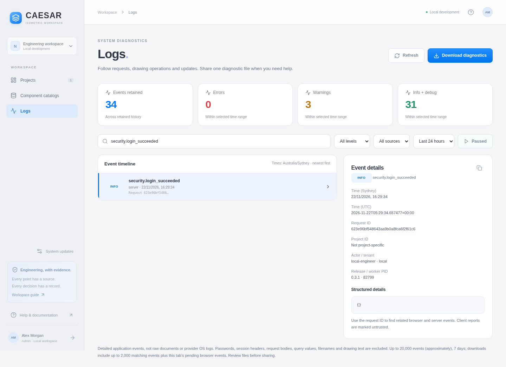

# Logs and support diagnostics — release 0.3.1

The hosting administrator has a **Logs** tab in the left sidebar. It shows a
live event timeline, level/source/time/search filters, older-event pagination,
colour-coded severity, and expandable structured details. Selecting a row pauses
the live feed. Times display in Australia/Sydney, with UTC shown in the detail
panel. Copy an event or download a JSON diagnostic bundle for troubleshooting.

## Troubleshoot with the assistant

1. Reproduce the issue, noting the action and approximate time.
2. Open Logs, choose the relevant time range and inspect ERROR/WARNING events.
3. Select a row. Search its request ID to follow related server/browser phases.
4. Download diagnostics with the desired filters. Review the file, then attach
   it to the conversation. Include what you expected and what actually happened.

The download contains up to 2,000 newest matching stored events, environment
summary (release, Python version, OS family), storage/capture counters and this
tab's pending structured browser events. It does not send anything to the
assistant or another third-party service automatically. Logs before this
release was installed cannot be reconstructed.

## Captured detail

- API/static responses passing through Python: server-generated request IDs,
  method, matched route template, status, duration through response completion,
  transferred byte counts, incomplete/error status, worker PID and release.
- Authenticated actor ID/tenant and validated project UUID, without login email,
  password, cookies or authorization headers. Failed logins have a fixed reason.
- Project mutation start/completion, revision and sheet/node/material/issue counts.
- PDF input byte/page counts and hashes, parser start/success/rejection/timeout,
  exit status, export stages/cache hits/artifact IDs and annotation counts.
- Catalog import/mapping/approval counts and statuses, without worksheet/record
  text or filenames.
- WSGI worker initialization/import failures when diagnostics can load, and safe
  Python exception class/frame metadata. No exception text, source snippets or
  local-variable dumps are retained.
- Update preparation, package verification, staged boot, backup, activation,
  restart/health result, failure and rollback events, including cron actions.
- Structured browser navigation/actions, API timings/status/request IDs,
  JavaScript error classes/script coordinates, unhandled rejections, console-error
  occurrences, resource errors and invalid-form occurrences. Console arguments,
  raw JavaScript exception messages and form/file values are not collected.

An ERROR row can show HTTP 200 with `complete=false`/`stream_failed=true` if the
headers were sent before a streamed response failed. The actual HTTP status is
not fabricated. Browser timestamps are client-supplied and untrusted; server
timestamps record ingestion. Browser identity is the account authenticated when
the batch is ingested, not a certified claim about when each event occurred.

## Privacy and access

Log reading/export is restricted to the existing hosting administrator (`admin`
ID in authenticated hosting). Tenant administrators/viewers cannot retrieve
system-wide events. Authenticated browsers may submit only bounded, typed
diagnostic fields; there is no arbitrary message/payload endpoint. Batches are
limited to 32 KiB/20 events and 120 accepted events per user per minute.

Bodies, query values, headers, document text, filenames, console arguments,
raw exception messages and environment dumps are omitted. Sensitive field names,
recognized secret assignments, known secret environment values and email
patterns receive additional redaction. This is a defined diagnostic schema,
not a guarantee against a developer deliberately adding sensitive fields in
future code. Keep captured fields metadata-only and retain privacy regressions.

Events live outside public_html/code in `CAESAR_DATA_DIR/diagnostics/events.sqlite3`
with an owner-only directory and mode-600 database. This is separate from the
engineering database and existing project audit trail. API poll/ingestion events
for successful logging requests are suppressed to avoid logging feedback; failed
access/ingestion attempts remain visible. Metadata logging does not fix the
remaining application authentication/upload/sandbox hardening requirements.

## Retention and limits

Default retention is seven days and approximately 20,000 rows (pruning every
50 inserts). The database has a roughly 64 MiB page cap at the default SQLite
page size; indexes/journals and temporary exports also consume storage. Old data
is pruned without affecting projects. The in-memory browser queue holds at most
200 events; an unsent-event/drop count is included in the download. It is not
stored in localStorage. Normal browser batches flush periodically while visible
and on authenticated navigation.

Logging storage failures do not take normal project requests down. A dropped
event counter is visible for the queried server process and notices are rate
limited on private stderr. That counter is not a cross-worker aggregate. Under
disk failure, contention, browser closure or process failure some events can be
lost; this system is not a lossless compliance audit archive.

## Hosting boundaries

This is application instrumentation, not recording every OS instruction or
browser variable. Public files served directly by Apache/LiteSpeed, provider
startup errors before Python/diagnostics can import, network/proxy failures and
other host services still require provider/browser logs. A browser whose main
JavaScript never loads cannot submit its own telemetry. Do not copy raw provider
logs or private configuration into chat without reviewing/redacting them.

The feature is code-compatible with schema 2 and unchanged dependencies. Publish
the new allowlisted package through the existing stable feed. Upgrading via the
existing updater preserves the diagnostic store outside the code directory;
rolling code back does not delete logs. If the hosting site has not yet installed
0.3.0's updater, use the newly pinned terminal installer once. GitHub publication
alone does not modify that hosting account.

## Processing jobs

Version 0.4.0 emits stage start/completion/failure, run/lease/attempt identifiers,
timings, page and exception counts, isolation capability, cancellation/retry,
cached correction and artifact-publication events. The Project flow view shows
the durable run state and source exceptions; Logs correlates server requests
with worker events. Source text/word evidence remains in authenticated project
evidence downloads rather than raw diagnostic messages. Per-page OCR output
and every drawing pixel are not copied into the log database. The existing
seven-day/20,000-row limits still apply.
