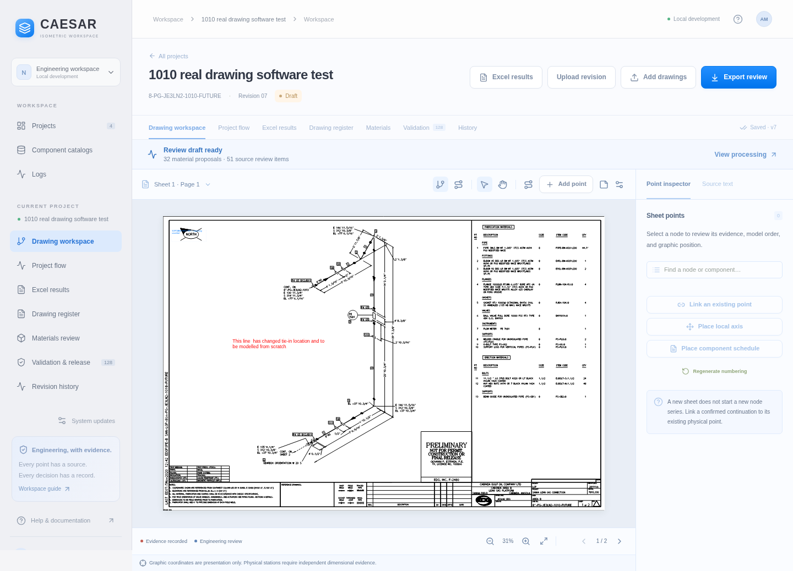
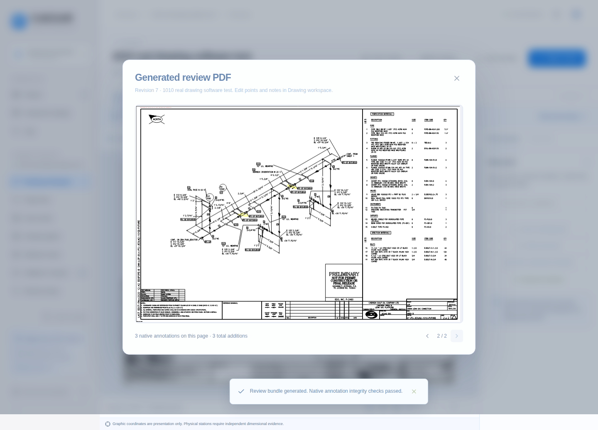

# Reviewed 1010 drawing: software validation

The user-provided [reviewed PDF](../fixtures/1010/1010%20Reviewed.pdf) is pinned
by SHA-256 in an integration regression and used by the real Chromium workflow.
The tests use disposable application storage, never the hosting account's
existing projects or credentials.

Screenshots from the tested local application:





## Workflow checked

- Create a project and upload the original two-page PDF through the website.
- Render both original sheets with PDF.js in the drawing workspace. Check actual
  rendered pixels and page controls, including the page with no searchable text.
- Add a graphical note, edit its position, save and reload the project.
- Generate and download a review ZIP; open both generated pages in the website.
- Check unchanged original-source SHA-256 and unchanged original content streams
  in the generated PDF. Retain the existing native review annotations and add
  editable native note objects.
- Record PDF intake/export phases and correlate the project in the Logs tab.
- Separately test a provisional graphical node with no physical station; it
  correctly remains `UNVERIFIED_DIMENSION` rather than acquiring guessed values.

Run from the repository root after setup/build:

```bash
.venv/bin/python -m unittest tests.integration.test_real_1010 -v
CAESAR_TEST_MOUNT=/stress .venv/bin/python tests/e2e/smoke.py
```

## What the real file revealed

The PDF is mostly outlined vectors, not a raster scan. Its 11,461 vector paths
include engineering lettering that has no searchable character representation.
The old heuristic described every page without extracted text as raster/OCR.
Inspection now reports vector paths, image counts and searchable-character
counts, and identifies the second page as **Vector/outlined-text review**.

Version 0.4.0 now rasterizes bounded regions for Tesseract OCR inside the isolated
parser and retains OCR word boxes, confidence and source hashes separately from
native text. The real browser workflow runs unattended intake, OCR, material
proposals and PDF/Excel review publication. Source text shows the OCR evidence
on page 2 while retaining the fact that native engineering text is absent.
Extracted material rows are unreviewed proposals, not authoritative quantities.
Physical points remain absent until the engineering route/dimensions are proved;
general component/dimension recognition remains unfinished in the
[automation backlog](AUTOMATION_BACKLOG.md).

The browser test also exposed an export requirement for engineering nodes in
both the browser and API, even for a notes-only review. Export now requires source sheets, so notes can be
reviewed and downloaded without adding fictional physical points. The regression
checks that the real-file browser project still has zero engineering nodes.

No authoritative node/material catalog output, 48/49 acceptance count, external
desktop-editor round trip or engineering sign-off is claimed. Tests of native
objects and independent browser rendering do not certify every PDF editor.

## Try it on the hosting account

After installing release 0.4.0 through **System updates** and enabling the
[processing runner](PROCESSING_PIPELINE.md), download the PDF from
GitHub, sign in at `https://easyai.com.au/stress/`, choose **New project**, enter
the title/full line ID and select that PDF. Open both sheets, add a review note,
save, export and preview. Open **Logs** to inspect the recorded upload/export
phases; download diagnostics if an error occurs. Keep test work labelled as
software validation and engineering unverified.

Open **Excel results → Components** to inspect OCR-derived rows and source
quantities, then download the editable workbook. Unknown lengths, counts and
weights remain blank or unresolved. Reproducible example outputs are retained
in [examples/1010-review](../examples/1010-review/README.md), clearly labelled
engineering unverified. They are actual system exports, not handwritten sample
workbooks or a fabricated native stress model.

The local browser test exercises the built application at `/stress`. An actual
hosted upload/export still needs the operator's authenticated browser; repository
publication alone cannot perform it. No production projects are created by an
update or by these tests.
